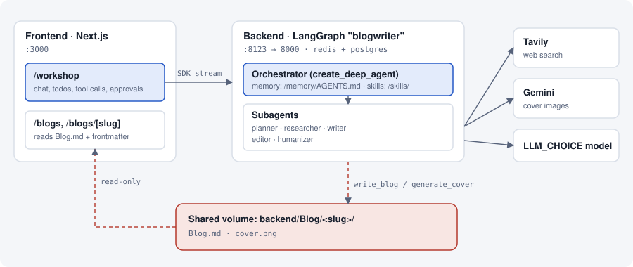

# BlogCrew ✍️🤖

BlogCrew is a multi-agent AI system that autonomously researches, writes, edits, and generates cover images for publish-ready blog posts. Built with DeepAgents + LangGraph, it splits work across specialized subagents (planner, researcher, writer, editor) and produces Markdown articles plus AI-generated covers.

Why use BlogCrew?

- Produces structured, reference-backed blog drafts.
- Built-in web research (Tavily) and image generation (Cloudflare Workers AI, free tier).
- Configurable subagent prompts and skills for control over voice & quality.

Quickstart (5 minutes)

1. Clone:
  ```bash
   git clone https://github.com/devgomesai/BlogCrew.git
   cd BlogCrew
  ```
2. Install deps (preferred):
  ```bash
   uv sync
  ```
   or
3. Copy `backend/.env.example` → `backend/.env` and set required keys, and
   `frontend/.env.local.example` → `frontend/.env.local`.
4. Run LangGraph Studio (from `backend/`):
  ```bash
   langgraph dev
  ```
   Open the printed URL and run the `blogwriter` graph.

Production notes — required configuration

- Python: 3.12+
- Environment variables (example):
  ```env
  LLM_CHOICE="provider:model"    # e.g. openrouter:anthropic/claude-sonnet-5
  TAVILY_API_KEY=your_tavily_api_key
  IMAGE_PROVIDER=pollinations    # pollinations | cloudflare | gemini
  POLLONATION_API_KEY=your_pollinations_api_key
  ```
- Cover images default to the Pollinations gen API running FLUX.1.1-pro, which
  needs `POLLONATION_API_KEY`. Alternatively set `IMAGE_PROVIDER=cloudflare` to
  use Cloudflare Workers AI FLUX.1 schnell on its free tier (roughly 170
  covers/day, no watermark, needs `CLOUDFLARE_ACCOUNT_ID` +
  `CLOUDFLARE_API_TOKEN`).
- The subagents' behavior is defined in `backend/src/subagents.yaml`; the model
  comes from `LLM_CHOICE` for every agent.

How it works (high level)

- Planner builds an H2/H3 outline.
- Researcher performs targeted web searches (Tavily) per section.
- Writer generates section text using the blog-writer skill and references.
- Editor polishes the whole draft and enforces validations.
- Humanizer strips AI tells from the edited draft — this is what gets saved.
- generate_cover uses the Pollinations gen API (FLUX.1.1-pro) to create a cover image saved alongside the article.

Architecture



- The Next.js `/workshop` page streams to the LangGraph `blogwriter` graph via the
  LangGraph SDK; the orchestrator delegates to the five subagents.
- Subagents call out to Tavily (search), the Pollinations image API (covers) and the `LLM_CHOICE` model.
- Posts are written to `backend/Blog/<slug>/`, a volume the frontend's `/blogs`
  reader mounts read-only.

Outputs

- `backend/Blog/<slug>/Blog.md` — generated article (Markdown, with YAML frontmatter:
  `title`, `date`, `description`, `tags`)
- `backend/Blog/<slug>/cover.png` — generated cover image

Project layout

```
├── backend/
│   ├── src/
│   │   ├── agent.py         # Orchestrator and backend mapping
│   │   ├── tools.py         # web_search, write_blog, generate_cover
│   │   ├── llm_service.py   # Model selection (LLM_CHOICE)
│   │   ├── subagents.yaml   # Planner/Researcher/Writer/Editor/Humanizer configs
│   │   ├── AGENTS.md        # Orchestrator manual loaded as /memory/AGENTS.md
│   │   └── test_tools.py    # Self-check: python -m src.test_tools
│   ├── skills/              # Skills (blog-writer, humanizer + references)
│   ├── Blog/                # Generated blog posts and covers
│   ├── langgraph.json
│   └── pyproject.toml
├── docs/                    # README assets (architecture.svg)
├── frontend/                # Next.js reader (/blogs) + workshop UI
└── start.ps1                # Launches backend (localhost) + frontend
```

Run locally (no Docker)

1. Copy `backend/.env.example` → `backend/.env` and fill in `LLM_CHOICE`, the
   provider key it needs, `TAVILY_API_KEY`, `GOOGLE_API_KEY`, and
   `LANGSMITH_API_KEY`.
2. Copy `frontend/.env.local.example` → `frontend/.env.local` (or use the
   provided `frontend/.env.local`) and set:
   ```env
   NEXT_PUBLIC_DEPLOYMENT_URL=http://localhost:8123
   NEXT_PUBLIC_ASSISTANT_ID=blogwriter
   ```
3. From the repo root, run the launcher:
   ```powershell
   powershell -ExecutionPolicy Bypass -File .\start.ps1
   ```
   This starts the backend on `http://localhost:8123` and the frontend on
   `http://localhost:3000`, then opens the workshop URL.
4. Stop by closing the two PowerShell windows the launcher opens.

Posts live in `backend/Blog/`: the backend writes them there, and the frontend
reads them straight off the local filesystem
(`frontend/src/lib/blogs.ts` → `backend/Blog/`). Both must run on the same box.
On Vercel or any serverless host there is no sibling `backend/` directory, so
`/blogs` would render empty. Serving `Blog/` over HTTP from the backend is the
upgrade path if that day comes. There is also no auth or rate limiting on the
workshop page — don't expose it to the internet as-is.

Windows-specific note
The project uses a CompositeBackend that maps virtual paths (/memory/, /skills/) to local directories to avoid a FilesystemBackend path-resolution issue on Windows. Do not change that routing unless testing on non-Windows environments.

Development

- Use `uv sync` to install dev dependencies (preferred). Python >=3.12 required.
- Edit skill prompts and `src/AGENTS.md` to change pipeline behavior — most logic lives in markdown prompts, not code.

Contributing

- Open issues or PRs. For major changes, file an issue first describing the goal and design.
- Keep changes small and document prompt/skill changes in commit messages.

Troubleshooting

- No output files: check `.env` and that `LLM_CHOICE` and API keys are valid.
- Model errors: ensure provider-specific keys are present and the `LLM_CHOICE` format is `provider:model`.

Credits & License

- Inspired by LangChain DeepAgents content-builder example.
- Repository: [https://github.com/devgomesai/BlogCrew](https://github.com/devgomesai/BlogCrew)

